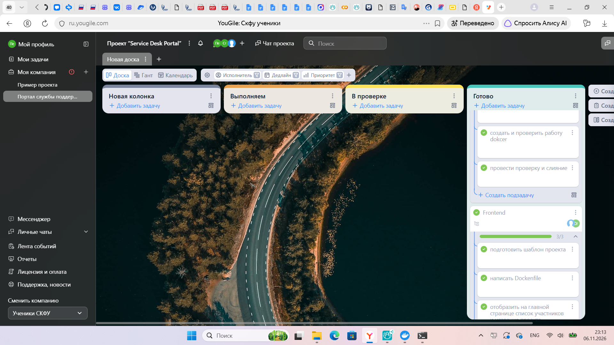
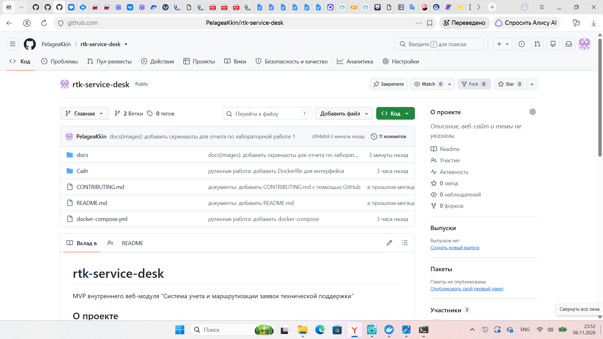
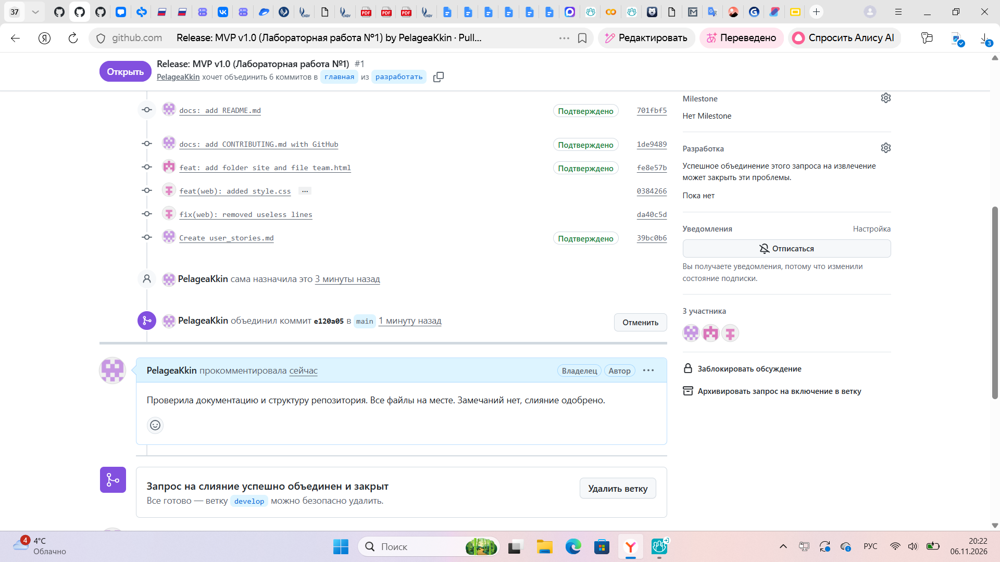
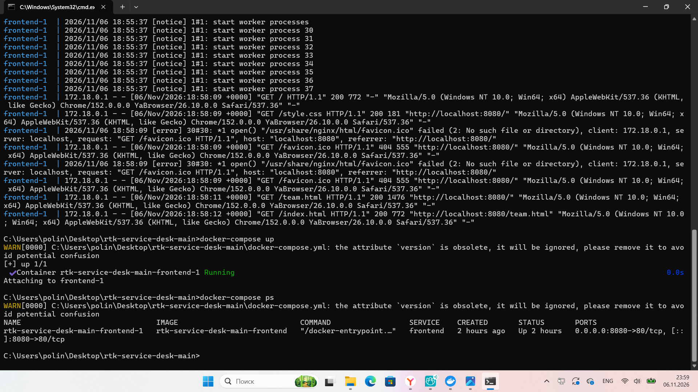
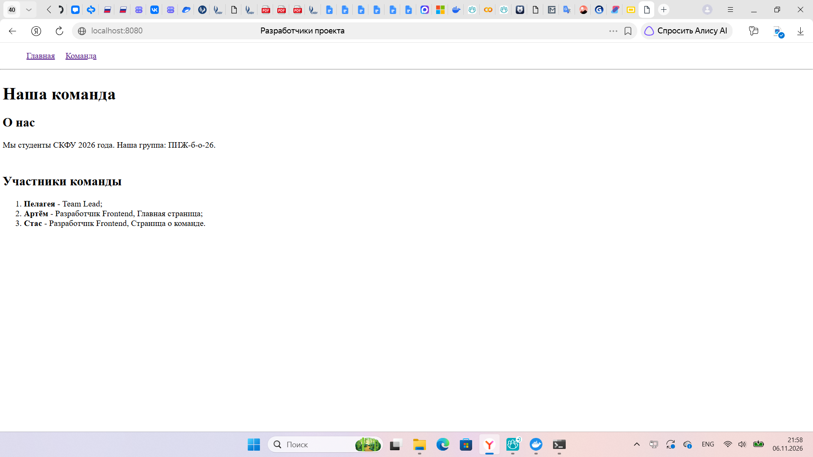

# Отчет по лабораторной работе №1
**Тема:** Инициализация проекта и настройка DevOps-окружения по регламенту индустриального партнёра
**Проект:** rtk-service-desk
**Дата:** 06.11.2026

## Состав команды
* **Пелагея** - Team Lead;
* **Артём** - Разработчик Frontend, Главная страница;
* **Стас** - Разработчик Frontend, Страница о команде.

---

## 1. Организация работы в трекере задач
Создан эпик проекта. Все задачи переведены в статус «Готово».

## 2. Структура репозитория
Настроена структура папок согласно регламенту: `/backend`, `/frontend`, `/docs`, корневой `docker-compose.yml`. Добавлены базовые файлы `README.md`, `CONTRIBUTING.md`, `.gitignore`.

## 3. Процесс разработки и Merge Requests
Каждый участник работал в своей ветке `feature/IC-01_<роль>_initial_setup`, коммиты оформлены.
Все изменения прошли процедуру Code Review и были слиты в ветку `develop`.

## 4. Развертывание проекта
Базовое Docker-окружение настроено. Многоконтейнерное приложение (Frontend) успешно запускается одной командой `docker-compose up`.

**Результат работы Frontend:**
Главная страница приложения отображает название проекта и состав команды.

---

## Вывод
В ходе выполнения работы была сформирована команда, настроено рабочее пространство по методологии GitFlow и стандарту Conventional Commits. Основной трудностью стала синхронизация веток и настройка сетевого взаимодействия контейнеров Docker. Проблема была решена путем добавления сервисов в общую сеть `docker-compose.yml` и внимательной проверки портов.
